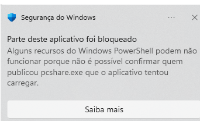

# PCShare — Arquitetura

Documento vivo. Registra as decisões estruturais e o *porquê* de cada uma.
Alterar uma decisão aqui é barato; alterar depois de 5.000 linhas de código, não.

---

## Princípio norteador

Três riscos técnicos definem se este produto existe. Todos devem ser atacados
**antes** de qualquer investimento em contas, billing ou painel web:

1. **Latência e qualidade de imagem** — se não for fluido, não é vendável.
2. **UAC / Secure Desktop** — se não funcionar na tela de UAC e de bloqueio,
   não serve para suporte remoto real.
3. **Reputação junto a antivírus** — se o instalador for bloqueado, não chega
   ao cliente.

Tudo o mais é trabalho conhecido.

---

## Topologia

```
┌──────────────────┐                          ┌──────────────────┐
│  HOST            │                          │  VIEWER          │
│  (controlado)    │                          │  (controlador)   │
│                  │                          │                  │
│  captura DXGI    │◄──── input events ──────►│  janela + decode │
│  encode H.264    │───── video stream ──────►│                  │
└────────┬─────────┘                          └────────┬─────────┘
         │                                             │
         │         ┌───────────────────────┐           │
         └────────►│  SINALIZAÇÃO          │◄──────────┘
                   │  troca de SDP/ICE     │
                   │  autenticação, IDs    │
                   │  NUNCA vê o vídeo     │
                   └───────────┬───────────┘
                               │
                   ┌───────────▼───────────┐
                   │  TURN (coturn)        │
                   │  fallback quando P2P   │
                   │  não fecha (~10-20%)  │
                   └───────────────────────┘
```

---

## Decisões

### D1 — Rust no cliente

Binário único, sem runtime, sem dependência de VC++ redistributable.
Importa por três motivos, em ordem de peso:

1. Menor superfície para falso-positivo de antivírus que um Electron de 150 MB.
2. Controle sobre alocação e cópias no caminho do vídeo (onde a latência mora).
3. Bindings oficiais da Microsoft para as APIs do Windows (crate `windows`).

**Descartado:** Electron. Rápido para MVP, mas não resolve secure desktop e tem
exatamente o perfil que antivírus sinaliza em software de controle remoto.

### D2 — Captura via DXGI Desktop Duplication

Entrega a textura já na GPU **e as dirty rects** — a lista de retângulos que
mudaram desde o último frame.

As dirty rects são o ponto central de desempenho, não um detalhe. Numa tela de
escritório parada, quase nenhum pixel muda entre frames. Codificar a tela
inteira a 30 fps é desperdiçar 95% da banda e do CPU.

**Descartado:** `mss`, GDI `BitBlt`, screenshots. Não expõem dirty rects,
copiam da GPU para a CPU a cada frame, e ensinam o padrão errado.

### D3 — Encode H.264 por hardware, sem sair da GPU  ✅ IMPLEMENTADO

Quick Sync / NVENC / AMF conforme a GPU disponível, com fallback para encoder
por software (openh264) quando não houver hardware.

H.264 e não AV1/HEVC: é o único com encoder por hardware universalmente
presente. AV1 é melhor, mas exclui toda máquina anterior a ~2021 — inaceitável
num produto cujo cliente instala na máquina alheia.

> **Máquina de desenvolvimento atual: Intel HD Graphics 4600 (Haswell, 2013),
> monitor 1360×768 nativo.** Tem Quick Sync H.264, não tem HEVC nem AV1.
> Tratar como **piso de compatibilidade**: se ficar fluido nela, roda em
> qualquer lugar. Não usar para medir o teto de qualidade.
>
> A resolução do monitor não permite validar 1080p ponta a ponta. Encode é
> testado com frame sintético — ver a seção de restrição em `SPRINT-0.md`.

**Caminho de pixels, implementado na Fase 1.** A textura nunca sai da memória
de vídeo: a Desktop Duplication entrega BGRA na GPU, o processador de vídeo do
D3D11 converte para NV12 ali mesmo, e a textura resultante vai ao encoder
embrulhada num `IMFSample` via `MFCreateDXGISurfaceBuffer`.

Exige que captura, conversor e encoder **compartilhem um único dispositivo
D3D11** — texturas não atravessam dispositivos. Daí o crate `pcshare-gpu`
existir separado dos outros dois. O dispositivo precisa de
`D3D11_CREATE_DEVICE_VIDEO_SUPPORT` e de proteção multithread: o Media
Foundation chama o encoder das próprias threads, e sem a proteção o dispositivo
corrompe em silêncio.

Medido a 1360×768, custo total por quadro no host:

| | leitura GPU | conversão | encode | total |
|---|---|---|---|---|
| memória de sistema | 5,37 ms | 2,06 ms | 4,29 ms | **11,72 ms** |
| GPU direto | — | 0,08 ms | 3,57 ms | **3,65 ms** |

3,2× mais rápido. O encode também caiu porque o encoder deixou de precisar
subir o quadro para a GPU.

> A conversão aparecer como 0,08 ms **não** significa que a GPU fez o trabalho
> nesse tempo: `VideoProcessorBlt` é assíncrono e apenas enfileira. O custo real
> aparece dentro do encode, que espera. Só o total de 3,65 ms tem significado; a
> divisão entre as duas colunas, não.

O caminho por memória de sistema continua no código como referência de
comparação (`--cpu-path`) e como plano B: encoders de software e drivers
antigos não aceitam texturas, e `H264Encoder::is_gpu_direct` decide qual usar.

### D3 (histórico) — por que H.264 e não AV1

### D4 — Transporte atrás de uma abstração  ✅ TROCA REALIZADA

O Sprint 0 usou TCP na LAN. A Fase 2 trocou por **QUIC**.

A troca **não podia** exigir reescrever a pipeline de vídeo, e não exigiu: o
host e o viewer conversam com o trait `Transport` e nenhuma linha de captura,
codec ou exibição mudou. A abstração se pagou.

**Por que QUIC, e não WebRTC.** O que precisávamos do WebRTC era a
independência entre fluxos e o transporte sobre UDP (base da travessia de NAT).
DTLS e SCTP seriam redundantes: a criptografia ponta a ponta já vem do Noise
(D7), que ainda dá autenticação por senha — coisa que o DTLS não daria.

**Mapeamento dos canais:**

- **Controle** — um fluxo bidirecional, confiável e ordenado, vivo pela sessão.
- **Mídia** — **um fluxo unidirecional por quadro**. Cada quadro é confiável em
  si e independente dos outros: um quadro atrasado não segura o próximo.

Isto corrige o defeito registrado desde a etapa 3: sobre TCP, um pacote de
vídeo perdido segura tudo que vem atrás e **congela a tela inteira** por um
tempo de ida e volta. A medição da etapa 3 não flagrou nada porque foi feita em
127.0.0.1, onde não há perda. Coberto agora pelo teste
`controle_nao_espera_a_midia`: um quadro de 2 MB não atrasa um comando.

O TCP continua no código (`--tcp`) para comparação.

> **Três defeitos que a troca expôs, todos na camada Noise.** A entrega
> independente quebrou suposições que o TCP escondia:
>
> 1. **Ordem.** O Noise numera as mensagens implicitamente. Passou a enviar o
>    número explícito, com janela deslizante anti-repetição.
> 2. **Mistura de mensagens.** Pedaços de mensagens diferentes se intercalam;
>    concatená-los num buffer por canal produzia lixo. Entrou identificador de
>    mensagem.
> 3. **Pedaço final chegando primeiro.** Uma marca de "último" não basta — ele
>    sozinho parecia mensagem completa. Entraram índice e total.
>
> Os três só apareceram rodando, não compilando. É a razão de cada etapa ter
> um teste que a trava.

### D5 — Arquitetura de dois processos no host (a partir da Fase 3)

```
pcshare-service.exe    → Windows Service, sessão 0, SYSTEM
        │                 sobrevive a logoff, vê a tela de bloqueio
        │ WTSQueryUserToken + CreateProcessAsUser
        ▼
pcshare-agent.exe      → um por sessão de usuário
                         captura, encode, injeta input
                         se anexa ao desktop Winlogon durante UAC
```

Este é o item de maior risco de cronograma do projeto inteiro. Não é opcional
e não dá para "adicionar depois" — a separação de processos precisa estar
prevista no design desde já, mesmo que o Sprint 0 rode como processo único.

### D6 — Sinalização não trafega vídeo

Servidor de sinalização faz autenticação, resolve ID → peer, e intermedeia a
troca de SDP/ICE. Uma vez estabelecida a sessão, sai do caminho.

**Consequência de negócio:** quando o P2P não fecha, o tráfego cai no TURN e
*toda* a banda de vídeo passa por você. É o principal custo variável de
infraestrutura e precisa estar na precificação desde o começo.

### D7 — Criptografia ponta a ponta, com verificação de identidade  ✅ IMPLEMENTADO

DTLS-SRTP do WebRTC já dá E2E entre os peers, inclusive através do TURN (o
relay só encaminha pacotes cifrados).

Mas isso sozinho **não** protege contra MITM feito pelo próprio servidor de
sinalização. É necessário verificar a chave pública do peer fora da banda —
modelo ID + senha, com fingerprint fixado no primeiro pareamento.

**Implementação:** `Noise_XXpsk3_25519_ChaChaPoly_BLAKE2s`, via `snow`.
Handshake criptográfico próprio é onde código caseiro falha em silêncio —
funciona nos testes e não protege de ninguém. O Noise tem análise formal
publicada.

- **XX** — autenticação mútua sem conhecimento prévio de chaves. Necessário
  porque na primeira conexão o viewer não sabe nada sobre o host.
- **psk3** — a senha entra como chave pré-compartilhada. Quem não a tem não
  conclui o handshake e não vê um pixel.
- PSK = `Argon2id(senha, sal = chave pública do host)`. KDF caro porque a
  senha é curta e digitada por gente; sem ele, um dicionário inteiro cai em
  minutos.

O host anuncia sua chave pública em claro — ela é a identidade, não segredo.
Um intermediário que a substitua faz o viewer derivar outra PSK, e o handshake
falha. A senha nunca trafega, em forma alguma.

> **Confirmação de chave, e não é formalidade.** Em `XXpsk3` a senha entra na
> terceira mensagem, que o iniciador **envia**. Ele conclui o handshake sem
> jamais comprovar que o outro lado a conhece — e, com senha errada, anunciava
> "autenticado" enquanto o host já tinha recusado. Observado em teste.
>
> Não havia vazamento: as chaves de transporte divergem e nada trafega. Mas um
> viewer que declara sucesso e só descobre o erro quando a conexão cai é
> inaceitável num produto cuja promessa central é a autenticação. O responder
> passa a enviar a impressão do handshake cifrada, e o iniciador só considera
> a sessão válida depois de decifrá-la.

**Limite conhecido:** o modo de transporte do Noise numera as mensagens
implicitamente, exigindo decifragem **em ordem**. Sobre TCP é garantido; o
canal de mídia melhor-esforço da Fase 2 vai exigir números de sequência
explícitos.

**Pendente:** a chave privada fica em texto claro em `%LOCALAPPDATA%\PCShare`.
O produto precisa protegê-la com DPAPI e permissões restritas (Fase 3).

### D8 — Esperar por evento, nunca por relógio

Nenhum laço do caminho de vídeo ou de input pode usar `thread::sleep` para
aguardar trabalho. Só espera bloqueante em evento: `AcquireNextFrame` da
captura, `GetEvent` do MFT, leitura bloqueante ou IOCP no socket.

**Medido na etapa 3:** um laço com `sleep(200 µs)` produziu RTT de 1,27 ms em
127.0.0.1; o mesmo laço com `yield_now` produziu 0,061 ms. Fator de 21. O
Windows não honra sleeps de sub-milissegundo — o pedido de 200 µs virou mais de
1 ms de espera real.

Num orçamento de 80 ms atravessando captura, encode, rede, decode e
apresentação, cada estágio que espera por relógio em vez de evento doa mais de
1 ms para nada.

> **Não use spin como solução.** `yield_now` num laço queima um núcleo, e
> "cliente leve" é requisito de produto (decisão D1). O spin serviu para
> *medir* o custo do sleep, não para eliminá-lo. A resposta é espera
> bloqueante.

---

## Riscos não-técnicos com impacto em arquitetura

### R1 — Assinatura de código  ⚠️ JÁ OBSERVADO

Sem certificado, o SmartScreen bloqueia a instalação e antivírus dão
falso-positivo. Custo recorrente (OV ~R$1.500–3.000/ano; EV mais caro, mas
dispensa a reputação acumulada).

Consequência de arquitetura: número de binários assinados deve ser mínimo, e a
cadeia de atualização automática precisa validar assinatura.

> **Aconteceu na etapa 4, na máquina de desenvolvimento.** O
> `pcshare-spike.exe` rodou uma vez e, na recompilação seguinte, foi bloqueado:
> *"Uma política de Controle de Aplicativo bloqueou este arquivo"*. A máquina
> tem **Smart App Control em imposição**
> (`HKLM:\SYSTEM\CurrentControlSet\Control\CI\Policy` →
> `VerifiedAndReputablePolicyState = 1`).
>
> Isto eleva R1 de incômodo a **restrição de entrada no mercado**. O Smart App
> Control vem ligado por padrão em instalações limpas de Windows 11 e bloqueia
> executáveis sem assinatura confiável ou reputação acumulada — exatamente o
> perfil de um produto novo de acesso remoto. O cliente que mais precisa da
> instalação simples é justamente o de máquina nova.
>
> A verificar antes de definir preço e prazo de lançamento: se um certificado
> OV basta ou se o EV é obrigatório para passar pelo Smart App Control, e
> quanto tempo leva para acumular reputação a partir do zero.

**OV e EV, a diferença que importa:**

| | OV (Organization Validation) | EV (Extended Validation) |
|---|---|---|
| Verificação | que a empresa existe: CNPJ, endereço | existência legal, presença física, operação |
| Reputação no Windows | **precisa ser construída** | **imediata** |
| Custo | menor | bem maior |
| Emissão | dias | semanas |

A linha da reputação é a decisiva. Com OV, mesmo assinado, o Windows continua
avisando o usuário até acumular downloads suficientes — ou seja, **os primeiros
clientes veriam avisos**. Com EV, não há essa carência.

Dois detalhes práticos que costumam surpreender:

- Desde 2023 a chave privada precisa viver em **hardware** ou serviço
  equivalente, não mais num arquivo. Isso muda como a assinatura entra na
  compilação.
- A Microsoft oferece um serviço de assinatura por mensalidade, sem token
  físico, que pode mudar a conta inteira para um fornecedor pequeno. **Verificar
  disponibilidade e termos atuais** — é informação que envelhece rápido.

**Pesquisa adiada em 10/08/2026**, a pedido. Não depende de código e pode
correr em paralelo com o desenvolvimento.

**A mensagem que o Windows mostra, capturada em 03/08/2026:**



> *"Parte deste aplicativo foi bloqueado. Alguns recursos do Windows PowerShell
> podem não funcionar porque **não é possível confirmar quem publicou**
> `pcshare.exe` que o aplicativo tentou carregar."*

O texto nomeia a causa sem rodeios: **falta de assinatura digital**. Não é
heurística de comportamento, não é falso positivo de antivírus, não é algo que
se resolva escrevendo o código de outro jeito. O sistema não sabe quem
publicou o binário e por isso o recusa.

Guardar esta captura tem um propósito: **é exatamente a tela que o cliente
veria** ao instalar o produto sem certificado. Serve de argumento pronto quando
o custo do certificado for discutido.

> **Agravante observado em 10/08/2026: o Smart App Control bloqueia o
> *serviço*.** O log de eventos do Windows registra, no evento 7000: *"Não foi
> possível iniciar o serviço PCShare — supervisor de agentes devido ao
> seguinte erro: Uma política de Controle de Aplicativo bloqueou este
> arquivo."*
>
> Com executáveis comuns o bloqueio era intermitente; com o serviço foi
> consistente, seis tentativas seguidas. E é o pior lugar para acontecer: o
> serviço é justamente a peça que precisa estar instalada na máquina do
> cliente para o UAC funcionar.
>
> Isso eleva a assinatura de código de "custo de lançamento" para
> **pré-requisito da Fase 3 em produção**.

**Desligar o Smart App Control é solução de bancada, não do produto.** Vale a
pena ser explícito porque a leitura contrária inviabilizaria o negócio: nenhum
cliente vai mexer em configuração de segurança, e o cliente típico de suporte
remoto é justamente quem não saberia fazê-lo.

O que enfrentamos em desenvolvimento é o pior caso possível — binário sem
assinatura, reputação zero (cada `cargo build` gera um hash inédito) e
comportamento de captura de tela mais injeção de entrada. O bloqueio é o
sistema funcionando como projetado.

| | desenvolvimento | produto |
|---|---|---|
| binário | recompilado a toda hora, hash novo | release assinado, hash estável |
| solução | desligar o SAC nas nossas máquinas | certificado de assinatura |
| máquina do cliente | — | **SAC continua ligado** |

A concorrência instala normalmente em máquinas com SAC ativo porque distribui
binários assinados. É custo, não impedimento.

> **Ressalva para um recurso futuro.** Se o suporte a *host headless* (máquina
> sem monitor) for implementado com driver de display virtual, driver é outro
> patamar de assinatura: exige atestação ou WHQL pelo portal de parceiros da
> Microsoft — processo mais caro e mais demorado que assinar um executável.
> Considerar antes de prometer o recurso.

### R2 — Abuso por golpistas (mercado brasileiro)

Acesso remoto é o vetor principal do golpe do falso suporte no Brasil.

Requisitos derivados, obrigatórios já no MVP:

- Indicador visual **persistente e não-ocultável** de sessão ativa na máquina controlada.
- Trilha de auditoria de sessões (quem, quando, de onde, duração).
- Rate limit agressivo em contas e IDs recém-criados.
- Mecanismo de bloqueio/banimento de conta.

### R3 — Bloqueio por aplicativos bancários

Apps de banco detectam e bloqueiam sessões de acesso remoto ativo. Testar cedo
se o nicho escolhido tiver qualquer proximidade com financeiro.

### R4 — LGPD

Sessão remota acessa dados pessoais de terceiros. Consentimento explícito
registrado e trilha de auditoria não são opcionais.

---

## Fases

| Fase | Escopo | Critério de saída |
|---|---|---|
| **0** | Spike LAN: captura → encode → TCP → decode → exibe → input | 30 fps @ 1080p, latência glass-to-glass < 80 ms na LAN |
| **1** | Criptografia, ID + senha, pareamento com fingerprint | Sessão segura entre duas máquinas na LAN |
| **2** | WebRTC/ICE, servidor de sinalização, TURN | Conexão entre redes distintas, atrás de NAT |
| **3** | Windows Service + agent, UAC, tela de bloqueio, instalador | Suporte remoto real numa máquina que você não pré-configurou |
| **4** | Contas, planos, painel, atualização automática, auditoria | Produto vendável |
